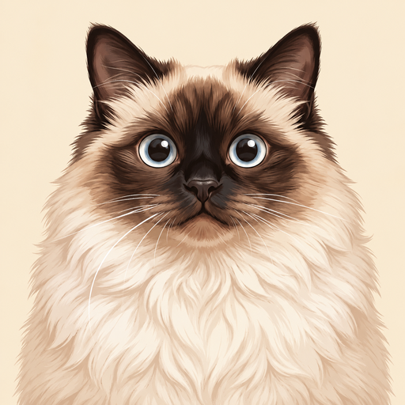

# LazyCatBot Chess Engine
<div align="center">

  

  [![License][license-badge]][license-link]
  [![Release][release-badge]][release-link]
  [![Last commit][commits-badge]][commits-link]

</div>

A lazy cat with a sharp tactical bite. LazyCatBot is a native C++20 UCI chess
engine built around a clean Lazy SMP search, Syzygy endgames and a local Lichess
dashboard. It is an engineering project, not a Stockfish replacement — and it
does not pretend to be one.

***

## Play against LazyCatBot

LazyCatBot plays on Lichess as [@LazyCatBot](https://lichess.org/@/LazyCatBot).
The account is a personal bot, so it may be offline between testing sessions.

Prebuilt Windows binaries are published on the
[Releases](https://github.com/gyzlk15/lazycatbot/releases) page. The engine is
also easy to build from source; see [Build](#build).

***

## What it is

LazyCatBot (the UCI engine identifies itself as `ChessBot 2.0 NNUE`) is written
from scratch in C++20. It does **not** use Stockfish as a backend. Stockfish 19
is used only as a local reference opponent in short test matches and as a source
of static evaluation labels for NNUE experiments.

- Bitboards, BMI2/PEXT and fallback magic bitboards.
- Lazy SMP with `Threads` 1–16 and a shared lockless transposition table.
- PVS, aspiration windows, null-move pruning, LMR/LMP, futility, razoring,
  ProbCut, SEE, quiescence search, killers/history/countermove, check extension
  and internal iterative reduction.
- Syzygy WDL/DTZ probing through [Fathom](third_party/fathom).
- Optional NNUE evaluation (`UseNNUE=false` by default; experimental).
- Local Lichess dashboard with an SVG board and move list.
- Polyglot book generator and a small real opening book in `data/books/`.

***

## Strength

Short matches against Stockfish 19 with `UCI_LimitStrength` at 100 ms/move:

| Opponent | Score | Games |
|---|---:|---:|
| Stockfish 19, `UCI_Elo=2200` | +5 =1 -4 (55.0%) | 10 |
| Stockfish 19, `UCI_Elo=2500` | +4 =0 -6 (40.0%) | 10 |

These samples are tiny. The estimate is roughly **2200–2350 engine Elo with a
wide confidence interval** — not a human rating, and not a claim of 3000 Elo.
Full Stockfish is far stronger. Treat LazyCatBot as a sparring/analysis engine
and a Lichess bot, not as a Stockfish replacement.

More data: [`docs/BENCHMARKS.md`](docs/BENCHMARKS.md) and
[`docs/DEVELOPMENT.md`](docs/DEVELOPMENT.md).

***

## Build

### Windows (MinGW-w64)

Recommended PGO build:

```powershell
.\build_pgo.ps1
```

Plain build:

```powershell
.\build.ps1
```

Both scripts expect `g++` in `PATH`. The PGO build produces the faster binary
and copies it to `chessbot.exe`.

### CMake

```bash
cmake -S . -B build -DCMAKE_BUILD_TYPE=Release
cmake --build build -j
```

The supplied `Makefile` is MinGW/Windows-oriented; use CMake on Linux/macOS.
The engine uses `-march=native`, so build on the machine class where it will
run or adjust the flags.

***

## UCI options

| Option | Default | Description |
|---|---|---|
| `Hash` | 64 MB | Transposition table size (1–4096 MB) |
| `Threads` | 1 | Lazy SMP workers (1–16) |
| `Move Overhead` | 30 ms | Time-management safety margin |
| `UseNNUE` | false | Experimental neural evaluation |
| `NNUEWeight` | 25 | NNUE blend weight (0–200) |
| `NNUEClip` | 80 | NNUE score clipping (0–1500) |
| `SyzygyPath` | empty | Tablebase directory (`dir1;dir2` on Windows) |
| `SyzygyProbeDepth` | 1 | Minimum depth for WDL probes |
| `Syzygy50MoveRule` | true | Respect the 50-move rule |
| `SyzygyProbeLimit` | 7 | Clamped by the available tables |
| `Clear Hash` | — | Clear the transposition table |

Quick start:

```text
uci
setoption name Threads value 4
setoption name Hash value 256
setoption name SyzygyPath value /path/to/syzygy
isready
position startpos
go movetime 1000
quit
```

`go nodes`, `go depth`, `go movetime`, `perft`, `bench`, `eval` and `d` are
supported.

***

## Lichess bot

This repository contains the engine, not the `lichess-bot` wrapper. Install the
wrapper separately:

```bash
git clone https://github.com/lichess-bot-devs/lichess-bot
```

Copy the example configuration and fill in your own token:

```bash
cp lichess/config.yml.example lichess-bot/config.yml
```

- Create a Lichess token with **only** the `bot:play` scope.
- Put the token in `lichess-bot/config.yml`; never commit that file.
- Set `engine.dir`, `engine.name` and the UCI options to match your build.
- Start with `python lichess-bot.py` or `start_bot.cmd` (the script expects
  `lichess-bot/` next to this repository).

More detail: [`docs/LICHESS.md`](docs/LICHESS.md).

***

## Dashboard

The optional dashboard shows live and recent Lichess games on a local SVG board.

```bash
pip install chess requests pyyaml
python tools/bot_dashboard.py --port 8765
```

Open <http://127.0.0.1:8765/>. The server binds to `127.0.0.1` by default and
reads the Lichess token server-side; the token is never sent to the browser.

More detail: [`docs/DASHBOARD.md`](docs/DASHBOARD.md).

***

## Testing

```bash
python tests/run_all.py
```

The suite covers perft, UCI protocol, timing, self-play and robustness. Some
reference probes expect a local Stockfish 19 binary under
`tools/sf19/stockfish/`; that directory is not included in the public repo.
The pure engine checks can be run without it.

Useful individual commands:

```bash
python tests/run_perft.py
python tests/run_stress.py --cycles 20 --threads 4 --movetime 50
```

Test report: [`tests/REPORT.md`](tests/REPORT.md).

***

## Project layout

```text
src/                 engine source
third_party/fathom/  Syzygy probing library (MIT)
tools/               arena, dashboard, book generator, puzzle tools
tests/               perft, protocol, timing, self-play, robustness
docs/                architecture, search, Syzygy, Lichess, dashboard, audit
data/books/          Polyglot opening book and manifest
training/            experimental NNUE training scripts
```

***

## Documentation

- [Architecture](docs/ARCHITECTURE.md)
- [Algorithms](docs/ALGORITHMS.md)
- [Search techniques](docs/SEARCH_TECHNIQUES.md)
- [Syzygy](docs/SYZYGY.md)
- [Lichess integration](docs/LICHESS.md)
- [Dashboard](docs/DASHBOARD.md)
- [Benchmarks](docs/BENCHMARKS.md)
- [Opening book](docs/BOOK.md)
- [Puzzle testing](docs/PUZZLES.md)
- [Engineering audit](docs/AUDIT.md)
- [Detailed development notes](docs/DEVELOPMENT.md)

***

## Acknowledgements

- [Fathom](https://github.com/jdart1/Fathom) for the Syzygy probing code.
- [python-chess](https://github.com/niklasf/python-chess) for the tooling,
  testing and dashboard support.
- The Lichess API and the `lichess-bot` project.
- Stockfish 19, used only as a local test/reference opponent and as a source of
  static evaluation labels for NNUE experiments.
- The Patricia chess engine README for layout inspiration.

***

## Security

- Never commit a Lichess token, GitHub token or API key.
- `lichess-bot/config.yml` and `.env` are ignored by git.
- Use [`lichess/config.yml.example`](lichess/config.yml.example) as a template.
- If a token was exposed, revoke it in the Lichess account settings and create
  a new one with only the `bot:play` scope.
- See [SECURITY.md](SECURITY.md) for the disclosure policy.

***

## License and third-party notices

The engine is released under the **GNU GPL v3 or later**; see [LICENSE](LICENSE).

Fathom is included under its MIT license. Stockfish 19 is **not** included or
linked; it is used only as a local test/reference opponent and as a source of
static evaluation labels for experiments. See [NOTICE.md](NOTICE.md) for the
full third-party notice.

***

## Other

If you know the UCI protocol, you can run LazyCatBot directly. Otherwise it
works with any major GUI: [Arena](http://www.playwitharena.de/),
[BanksiaGUI](https://banksiagui.com/), CuteChess, Nibbler, etc.

If you find a bug or have an idea, open an issue. If you build something cool
with LazyCatBot, feel free to share it.

[license-badge]: https://img.shields.io/github/license/gyzlk15/lazycatbot?style=for-the-badge
[license-link]: https://github.com/gyzlk15/lazycatbot/blob/master/LICENSE
[release-badge]: https://img.shields.io/github/v/release/gyzlk15/lazycatbot?style=for-the-badge
[release-link]: https://github.com/gyzlk15/lazycatbot/releases/latest
[commits-badge]: https://img.shields.io/github/last-commit/gyzlk15/lazycatbot?style=for-the-badge
[commits-link]: https://github.com/gyzlk15/lazycatbot/commits/master
